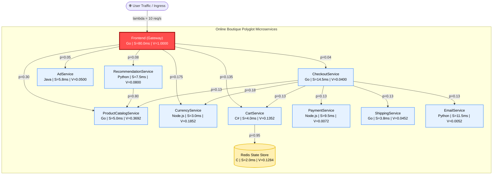

# SPE Project #2: Analytical QN/LQN Model of a Microservice Application

[](https://www.python.org/)
[-brightgreen.svg)](tests/)
[-success.svg)](scripts/audit_report.py)
[](api/app.py)
[](LICENSE)

---

## 📌 Executive Summary & Key Findings

This project develops, solves, and empirically validates an **Open Queueing Network (QN) and Layered Queueing Network (LQN)** analytical model for the **Google Online Boutique** 11-microservice benchmark on Kubernetes.

| Metric / Finding | Value / Result | Engineering Interpretation |
| :--- | :--- | :--- |
| **Binding Bottleneck** | **Frontend (Gateway)** | $D_0 = 80.00\text{ ms}$, operating at $80.00\%$ CPU @ $10\text{ req/s}$. |
| **Demand Imbalance** | **$43.2\times$ Disparity** | Frontend demand is $43.2\times$ larger than next heaviest service (ProductCatalog at $1.85\text{ ms}$). |
| **Optimization ROI Leverage** | **$95.91\%$** | Sensitivity derivative $\partial R/\partial S_0$ accounts for $95.91\%$ of all latency reduction potential. |
| **Optimal HPA Scaling Sweet Spot** | **$c = 3$ Replicas** | Expands saturation from $12.5 \to 35.2\text{ req/s}$ ($2.82\times$) with $78.5\%$ latency reduction at **$94.0\%$ USL efficiency**. |
| **Autoscaling Target Policy** | **$60\% - 70\%$ CPU** | Due to $M/M/1$ non-linear queue explosion as $\rho \to 1.0$, HPA must trigger before $70\%$ load. |
| **Validation Tier Error** | **$-57.0\%$** | Single-tier nominal load error ($285.0\text{ ms}$ measured vs $122.6\text{ ms}$ model) driven by container overhead. |

---

## 🏗️ Microservice Architecture & Call Topology



---

## ⚡ Quickstart: One-Command Reproduction

You can run the entire test suite, master consistency audit, queueing solver, and capacity planner with a single command:

**Windows (PowerShell):**
```powershell
.\run.ps1
```

**Linux / macOS:**
```bash
make all
# OR: ./run.sh
```

---

## Architecture Overview

Google Online Boutique is a cloud-native demo application with 11 microservices:

| Service              | Language | Role                                      |
|----------------------|----------|-------------------------------------------|
| Frontend             | Go       | HTTP server serving the website            |
| CartService          | C#       | Stores shopping cart in Redis              |
| ProductCatalogService| Go       | Provides product list and details          |
| CurrencyService      | Node.js  | Converts currencies                        |
| PaymentService       | Node.js  | Charges credit card (mock)                 |
| ShippingService      | Go       | Provides shipping cost estimates           |
| EmailService         | Python   | Sends order confirmation emails (mock)     |
| CheckoutService      | Go       | Orchestrates checkout flow                 |
| RecommendationService| Python   | Recommends products based on cart          |
| AdService            | Java     | Provides text ads based on context         |
| Redis                | C        | In-memory store for cart data              |

---

## Prerequisites

| Requirement       | Version   | Purpose                                           |
|--------------------|-----------|--------------------------------------------------|
| **Docker**         | 20.10+    | Run the Online Boutique microservices + monitoring |
| **Docker Compose** | v2+       | Orchestrate multi-container deployment             |
| **Python**         | 3.9+      | Run model scripts, API server, CLI                 |
| **Git**            | any       | Clone the repository                               |

> **Note:** Python is only required if you run the analysis scripts locally. You can alternatively run everything inside Docker (see [Running via Docker](#running-via-docker-optional)).

---

## Environment Setup

### 1. Clone the Repository

```bash
git clone <repository-url>
```

**Windows (PowerShell) — path contains spaces, so use quotes:**
```powershell
cd "Analytical QNLQN Model of a Microservice Application"
```

**Linux / macOS:**
```bash
cd "Analytical QNLQN Model of a Microservice Application"
```

### 2. Create a Python Virtual Environment

**Windows (PowerShell):**
```powershell
python -m venv .venv
.\.venv\Scripts\Activate.ps1
```

**Linux / macOS:**
```bash
python3 -m venv .venv
source .venv/bin/activate
```

### 3. Install Python Dependencies

```bash
pip install -r requirements.txt
```

This installs:
- `fastapi`, `uvicorn[standard]`, `pydantic` — REST API server
- `numpy`, `scipy` — numerical computation & MVA solver
- `pandas`, `matplotlib`, `seaborn` — data analysis & plotting
- `requests` — HTTP client for Prometheus/Jaeger queries
- `pyyaml` — YAML parsing for replica configs
- `pytest` — test framework

### 4. Verify the Installation

```bash
python -c "import fastapi, numpy, matplotlib; print('All dependencies OK')"
```

---

## Deploying the Online Boutique (Monitoring Stack)

The `deployment/` directory contains a Docker Compose file that brings up all 11 Online Boutique microservices along with the full observability stack.

### Start the Stack

```bash
cd deployment
docker-compose up -d
```

This launches the following containers:

| Container              | Port(s)                      | Description                           |
|------------------------|------------------------------|---------------------------------------|
| `frontend`             | `8080`                       | Online Boutique web UI                |
| `cartservice`          | —                            | Shopping cart (backed by Redis)        |
| `productcatalogservice`| —                            | Product catalog                       |
| `currencyservice`      | —                            | Currency conversion                   |
| `paymentservice`       | —                            | Payment processing (mock)             |
| `shippingservice`      | —                            | Shipping cost estimates               |
| `emailservice`         | —                            | Order confirmation emails (mock)      |
| `checkoutservice`      | —                            | Checkout orchestration                |
| `recommendationservice`| —                            | Product recommendations               |
| `adservice`            | —                            | Context-based advertisements          |
| `redis-cart`           | —                            | Redis for cart state                  |
| `loadgenerator`        | —                            | Built-in Locust-based load generator  |
| `prometheus`           | `9090`                       | Metrics collection                    |
| `jaeger`               | `16686`                      | Distributed tracing UI                |
| `grafana`              | `3100`                       | Dashboards                            |
| `cadvisor`             | `8081`                       | Container resource monitoring         |
| `otel-collector`       | `4317`, `4318`, `8889`       | OpenTelemetry Collector               |

### Verify the Deployment

Open your browser and check:
- **Frontend:** http://localhost:8080  
- **Prometheus:** http://localhost:9090  
- **Jaeger UI:** http://localhost:16686  

### Stop the Stack

```bash
cd deployment
docker-compose down
```

---

## Running a Load Test

The Docker Compose stack includes a built-in **load generator** (Locust-based) that automatically generates traffic against the frontend. By default it simulates **10 concurrent users**.

To change the number of simulated users, edit `USERS` in `deployment/docker-compose.yaml`:
```yaml
loadgenerator:
  environment:
    USERS: "20"    # Change this value
```

Then restart the load generator:
```bash
cd deployment
docker-compose restart loadgenerator
```

### Monitor the Load Test (Optional)

Use the provided scripts to monitor the load test and wait for data collection:

**Windows (PowerShell):**

> **⚠️ Windows Execution Policy:** By default, Windows restricts running unsigned PowerShell scripts. If you see an `UnauthorizedAccess` error, run the following command **once** in your current PowerShell window to bypass the restriction for that session:
> ```powershell
> Set-ExecutionPolicy -Scope Process -ExecutionPolicy Bypass
> ```

```powershell
.\scripts\load_testing\run_load_test.ps1                     # Default: 10 users, 5 minutes
.\scripts\load_testing\run_load_test.ps1 -Users 20 -Duration 600   # 20 users, 10 minutes
```

**Linux / macOS:**
```bash
./scripts/load_testing/run_load_test.sh              # Default: 10 users, 5 minutes
./scripts/load_testing/run_load_test.sh 20 600       # 20 users, 10 minutes
```

> **Tip:** Let the load generator run for at least **5 minutes** before collecting metrics, so Prometheus has enough data for accurate rate calculations.

---

## Collecting Empirical Metrics

Once the monitoring stack has been running and the load generator has produced traffic, collect metrics from Prometheus and Jaeger:

### Collect Service Metrics (from Prometheus)

```bash
python scripts/data_collection/collect_metrics.py
```

**Options:**
| Flag             | Default                    | Description                       |
|------------------|----------------------------|-----------------------------------|
| `--prometheus`   | `http://localhost:9090`    | Prometheus URL                    |
| `--jaeger`       | `http://localhost:16686`   | Jaeger URL (for container mapping)|
| `--output`       | `data/processed`           | Output directory                  |

This collects:
- Request rates (req/s) per service
- Mean response times (seconds) per service
- CPU utilization per service (from cAdvisor)

Output files are saved to `data/processed/` as timestamped CSV files and `service_times.json`.

### Extract Routing Probabilities (from Jaeger)

```bash
python scripts/data_collection/parse_traces.py
```

This analyzes Jaeger traces to compute the routing probability matrix and saves it to `data/processed/routing_probabilities.json`.

---

## Running the Queueing Network Model

### Basic Run (Default Parameters)

Run the model with estimated parameters from source code analysis:

```bash
python scripts/model/queueing_network.py
```

### Run with Empirical Data

Use the collected metrics as input parameters:

```bash
python scripts/model/queueing_network.py --data data/processed
```

### Run with a Custom Arrival Rate

```bash
python scripts/model/queueing_network.py --rate 15
```

### Sweep Arrival Rates & Generate Plots

Sweep from 1 to 50 req/s and generate utilization and response time plots:

```bash
python scripts/model/queueing_network.py --sweep --save
```

### Full Example (Empirical Data + Save + Sweep)

```bash
python scripts/model/queueing_network.py --data data/processed --rate 10 --save --sweep
```

**Command-Line Flags:**
| Flag                 | Default  | Description                                       |
|----------------------|----------|---------------------------------------------------|
| `--rate` / `--arrival`| `10.0`  | External arrival rate in req/s                    |
| `--data`             | `None`   | Path to empirical data directory                  |
| `--sweep`            | `False`  | Sweep arrival rates and generate performance plots|
| `--save`             | `False`  | Save predictions to `results/` and model params   |

**Output:**
- Console: per-service utilization, response times, throughput, and bottleneck analysis
- `results/model_predictions.json` — solver output (when `--save` is used)
- `results/figures/utilization_vs_arrival_rate.png` — utilization plot (when `--sweep`)
- `results/figures/response_time_vs_arrival_rate.png` — response time plot (when `--sweep`)
- `results/figures/system_response_time.png` — end-to-end response time (when `--sweep`)

---

## Validating Predictions Against Measurements

Compare model predictions with empirical data:

```bash
python scripts/validation/compare.py \
  --predictions results/model_predictions.json \
  --measurements data/processed/empirical_measurements.csv
```

### Run with Demo/Sample Data

If you don't have empirical data yet, use the built-in sample data:

```bash
python scripts/validation/compare.py --demo
```

**Command-Line Flags:**
| Flag             | Default                                           | Description                      |
|------------------|---------------------------------------------------|----------------------------------|
| `--predictions`  | `results/model_predictions.json`                  | Path to model predictions JSON   |
| `--measurements` | `None`                                            | Path to measurements CSV         |
| `--output`       | `results/figures`                                 | Output directory for figures     |
| `--demo`         | `False`                                           | Run with sample data             |

**Output:**
- Error metrics: RMSE, MAE, MAPE
- `results/figures/comparison_response_time.png` — bar chart of predicted vs. measured
- `results/figures/scatter_response_time.png` — scatter plot with perfect-prediction line
- `results/figures/error_heatmap.png` — per-service error heatmap
- `results/figures/comparison_summary.txt` — detailed text report

---

## Running the Full Workflow (CLI)

The CLI runner (`cli/run_all.py`) executes all steps in sequence:

1. Collect metrics from Prometheus/Jaeger
2. Solve the queueing network model
3. Validate predictions against empirical data
4. (Optionally) start the FastAPI server

```bash
python cli/run_all.py --arrival 10
```

### With Replica Overrides

Create a YAML file (e.g., `replicas.yaml`):
```yaml
Frontend: 2
CheckoutService: 3
```

Then run:
```bash
python cli/run_all.py --arrival 10 --replicas replicas.yaml
```

### With the API Server

```bash
python cli/run_all.py --arrival 10 --run-server --port 8000
```

**Command-Line Flags:**
| Flag           | Default | Description                                        |
|----------------|---------|-----------------------------------------------------|
| `--arrival`    | —       | **(Required)** External arrival rate in req/s       |
| `--replicas`   | `None`  | Path to YAML file with per-service replica counts   |
| `--run-server` | `False` | Start the FastAPI server after the workflow          |
| `--port`       | `8000`  | Port for the FastAPI server                         |

---

## FastAPI Server & Web Dashboard

The project includes a REST API and a web-based dashboard for interactive exploration.

### Start the API Server

> ⚠️ **Run from the project root directory** (not from `deployment/` or any subdirectory).

**Windows (PowerShell):**
```powershell
# Activate the virtual environment first
.\.venv\Scripts\Activate.ps1

# Start the server
uvicorn api.app:app --host 0.0.0.0 --port 8000 --reload
```

**Linux / macOS:**
```bash
source .venv/bin/activate
uvicorn api.app:app --host 0.0.0.0 --port 8000 --reload
```

Then open:
- **Web Dashboard:** http://localhost:8000  
- **API Docs (Swagger):** http://localhost:8000/docs  

The `--reload` flag automatically restarts the server when source files change (useful during development). Remove it for production.

### API Endpoints

#### `POST /solve`

Solve the queueing network for a given arrival rate:

```bash
curl -X POST http://localhost:8000/solve \
  -H "Content-Type: application/json" \
  -d '{"arrival_rate": 10.0}'
```

With replica overrides:
```bash
curl -X POST http://localhost:8000/solve \
  -H "Content-Type: application/json" \
  -d '{"arrival_rate": 10.0, "replicas": {"Frontend": 2, "CheckoutService": 3}}'
```

**Response:**
```json
{
  "arrival_rate": 10.0,
  "service_predictions": [
    {
      "service": "Frontend",
      "predicted_response_time_ms": 150.2,
      "utilization": 0.72,
      "visit_ratio": 1.0
    }
  ],
  "system_metrics": {
    "throughput": 10.0,
    "system_response_time_ms": 312.5
  }
}
```

#### `POST /api/v1/scale-prediction`

Scale-aware prediction with per-service replica overrides and Erlang-C queueing probabilities:

```bash
curl -X POST http://localhost:8000/api/v1/scale-prediction \
  -H "Content-Type: application/json" \
  -d '{"lambda": 10.0}'
```

With replica overrides:
```bash
curl -X POST http://localhost:8000/api/v1/scale-prediction \
  -H "Content-Type: application/json" \
  -d '{"lambda": 10.0, "replicas": {"frontend": 2, "checkoutservice": 3}}'
```

**Response fields:**
- `utilization` — per-service ρᵢ (offered load)
- `P_Q` — Erlang-C queueing probability at each service centre
- `response_time_ms` — per-service mean response time (ms)
- `queue_length` — mean number of requests in system (Little's Law)

#### `GET /measurements`

Return the empirical measurement data as JSON:

```bash
curl http://localhost:8000/measurements
```

---

## Running via Docker (Optional)

You can run all analysis scripts inside a Docker container without installing Python locally.

### 1. Build the Docker Image

```bash
docker build -t spe-model .
```

### 2. Run the QN Model

```bash
docker run --rm -v "${PWD}/results:/app/results" spe-model \
  python scripts/model/queueing_network.py --data data/processed --rate 10 --save --sweep
```

### 3. Run the Validation

```bash
docker run --rm -v "${PWD}/results:/app/results" spe-model \
  python scripts/validation/compare.py --measurements data/processed/empirical_measurements.csv
```

### 4. Start the API Server in Docker

```bash
docker run --rm -p 8000:8000 spe-model \
  uvicorn api.app:app --host 0.0.0.0 --port 8000
```

---

## Running Tests

The project includes unit tests for the MVA solver and integration tests for the API.

### Run All Tests

```bash
pytest tests/ -v
```

### Run Individual Test Files

```bash
pytest tests/test_solver.py -v    # MVA solver unit tests
pytest tests/test_api.py -v       # FastAPI integration tests
```

### Test Summary

| Test File          | Tests                                                                  |
|--------------------|------------------------------------------------------------------------|
| `test_solver.py`   | M/M/1 single node, M/M/c multi-server stability, closed-loop detection, textbook visit ratios |
| `test_api.py`      | GET /measurements, POST /solve (success, invalid input, replica overrides) |

---

## Service Dashboard

The project includes an **HTML Service Dashboard** (`dashboard.html`) that acts as a single entry point to every running interface. Instead of remembering ports and URLs, just open the dashboard and click the service you want to visit.

### Opening the Dashboard

**Option 1 — Double-click in File Explorer:**

Navigate to the project root folder and double-click **`dashboard.html`**. It opens in your default browser.

**Option 2 — From PowerShell:**

```powershell
Invoke-Item "dashboard.html"
```

**Option 3 — Paste in your browser address bar:**

```
file:///C:/Users/7172981/Downloads/Analytical%20QNLQN%20Model%20of%20a%20Microservice%20Application/dashboard.html
```

### What the Dashboard Links To

| Card                       | URL                              | Description                                              |
|----------------------------|----------------------------------|----------------------------------------------------------|
| **Online Boutique Frontend** | http://localhost:8080           | The e-commerce web app — browse, add to cart, checkout   |
| **QN Model API (FastAPI)** | http://localhost:8000             | REST API for the queueing-network solver                 |
| **API Docs (Swagger UI)**  | http://localhost:8000/docs        | Interactive OpenAPI documentation                        |
| **Prometheus**             | http://localhost:9090             | Metrics querying (PromQL)                                |
| **Prometheus Targets**     | http://localhost:9090/targets     | Scrape target health check — verify all targets are UP   |
| **Jaeger UI**              | http://localhost:16686            | Distributed tracing — explore traces and latencies       |
| **Grafana**                | http://localhost:3100             | Visual dashboards (credentials: `admin` / `admin`)       |
| **cAdvisor**               | http://localhost:8081             | Container CPU, memory, and network I/O stats             |
| **OTel Collector Metrics** | http://localhost:8889/metrics     | OpenTelemetry pipeline health metrics                    |

> **Tip:** Make sure Docker Compose is running (`docker-compose up -d` in the `deployment/` folder) before clicking the cards, otherwise the services won't be reachable.

---

## Monitoring Interfaces

When the Docker Compose stack is running, the following UIs are available:

| Interface              | URL                              | Credentials              |
|------------------------|----------------------------------|--------------------------|
| **Frontend**           | http://localhost:8080             | —                        |
| **Prometheus**         | http://localhost:9090             | —                        |
| **Prometheus Targets** | http://localhost:9090/targets     | —                        |
| **Jaeger UI**          | http://localhost:16686            | —                        |
| **Grafana**            | http://localhost:3100             | admin / admin            |
| **cAdvisor**           | http://localhost:8081             | —                        |
| **OTel Collector**     | http://localhost:8889/metrics     | —                        |
| **QN Model API**       | http://localhost:8000             | —                        |
| **API Docs (Swagger)** | http://localhost:8000/docs        | —                        |

### Useful Prometheus Queries

```promql
# Request rate per service
sum(rate(grpc_server_handled_total[5m])) by (grpc_service)

# Mean response time per service
sum(rate(grpc_server_handling_seconds_sum[5m])) by (grpc_service)
  / sum(rate(grpc_server_handling_seconds_count[5m])) by (grpc_service)

# CPU utilization per container
sum(rate(container_cpu_usage_seconds_total[5m])) by (container)
```

---

## Methodology

1. **Workload Measurement**: Collect arrival rates, service times, and utilization
   from Prometheus; extract routing probabilities from Jaeger traces.
2. **Model Construction**: Build an Open Queueing Network with each microservice
   as an M/M/1 (or M/M/c) service centre, parameterized by the collected data.
3. **Model Solution**: Solve via Mean Value Analysis (MVA) for throughput,
   response time, and utilization at each service.
4. **Validation**: Compare model predictions against empirical measurements
   and analyze deviations using RMSE, MAE, and MAPE.

---

## Project Report

The comprehensive project report containing all modeling results and validation analysis is at:

📄 **[docs/FINAL_REPORT.md](docs/FINAL_REPORT.md)**

Additional documentation:
- [Model Description](docs/model_description.md) — QN diagram, formulas, and service centre definitions
- [Validation Report](docs/validation_report.md) — detailed predictions vs. measurements analysis

---

## Troubleshooting

### 1. PowerShell Script Error: `UnauthorizedAccess` (Windows)

**Symptom:** Running `.\scripts\load_testing\run_load_test.ps1` fails with:
```
File ... is not digitally signed. You cannot run this script on the current system.
```

**Cause:** Windows restricts execution of unsigned PowerShell scripts by default.

**Fix:** Run the following command **once** in your current PowerShell window to temporarily allow script execution for that session only:
```powershell
Set-ExecutionPolicy -Scope Process -ExecutionPolicy Bypass
```
Then retry:
```powershell
.\scripts\load_testing\run_load_test.ps1
```

> **Note:** The `-Scope Process` flag limits the change to the current terminal session. It does not modify the system-wide policy and reverts automatically when you close the window.

---

### 2. `collect_metrics.py` / `run_all.py` Reports All Zeros

**Symptom:** Running `python cli/run_all.py --arrival 10` fails with:
```
Warning: No rate data for frontend
Warning: No rate data for productcatalogservice
...
RuntimeError: All collected metrics are zero.
```

**Cause:** Prometheus needs a steady stream of traffic for at least **3–5 minutes** to accurately calculate per-second rates (`req/s`) and latencies. If you run `run_all.py` too soon after `docker-compose up -d`, Prometheus has not yet accumulated enough data and returns empty results.

**Fix — Step by Step:**

1. **(If needed)** Bypass the PowerShell execution policy:
   ```powershell
   Set-ExecutionPolicy -Scope Process -ExecutionPolicy Bypass
   ```
2. Run the load-test monitor script (this waits 5 minutes while the load generator produces traffic):
   ```powershell
   .\scripts\load_testing\run_load_test.ps1
   ```
   Alternatively, you can simply **wait 5 minutes** after `docker-compose up -d` without running the script.
3. Once the 5-minute wait is complete, run the full workflow:
   ```powershell
   python cli/run_all.py --arrival 10
   ```

> **Tip:** You can verify that Prometheus is receiving data by opening http://localhost:9090/targets in your browser. All targets should show **State = UP**.

---

### 3. Docker Compose Fails to Start
- Make sure Docker Desktop is running.
- Ensure ports `8080`, `9090`, `16686`, `3100`, `8081` are not in use.
- Try `docker-compose down` then `docker-compose up -d` again.

---

### 4. Prometheus Returns No Data (After Waiting)
- Verify the services are running: `docker-compose ps`.
- Check the Prometheus targets page: http://localhost:9090/targets — all targets should show **UP**.
- If targets show **DOWN**, restart the monitoring stack:
  ```bash
  cd deployment
  docker-compose down
  docker-compose up -d
  ```
  Then wait 5 minutes before collecting metrics.

---

### 5. `ModuleNotFoundError` When Running Scripts
- Make sure you've activated the virtual environment and installed dependencies:
  ```bash
  source .venv/bin/activate   # Linux / macOS
  .\.venv\Scripts\Activate.ps1   # Windows PowerShell
  pip install -r requirements.txt
  ```

---

### 6. API Server Can't Find `queueing_network_parameters.json`
- Run the model with `--save` first to generate the parameters file:
  ```bash
  python scripts/model/queueing_network.py --save
  ```

---

### 7. Tests Fail with Import Errors
- Run tests from the project root directory:
  ```bash
  pytest tests/ -v
  ```

---

### 8. `PydanticUserError: "Config" and "model_config" cannot be used together`

**Symptom:** Uvicorn fails to start with:
```
pydantic.errors.PydanticUserError: "Config" and "model_config" cannot be used together
```

**Cause:** A Pydantic v2 model has both an inner `class Config` (v1 style) and `model_config` (v2 style) defined simultaneously.

**Fix:** This has already been resolved in `api/app.py`. If you see it again after modifying models, ensure each `BaseModel` subclass uses **only** `model_config` (v2 style) and `Field(alias=...)` — never the old inner `class Config`.

---

### 9. `CommandNotFoundException: vicorn` / Typo in uvicorn command

**Symptom:**
```
The term 'vicorn' is not recognized...
```

**Fix:** The correct command is `uvicorn` (with a leading `u`). Always run it from the **project root** directory:
```powershell
uvicorn api.app:app --host 0.0.0.0 --port 8000 --reload
```
